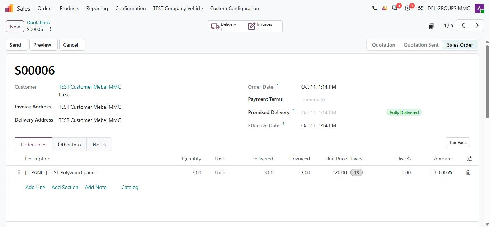
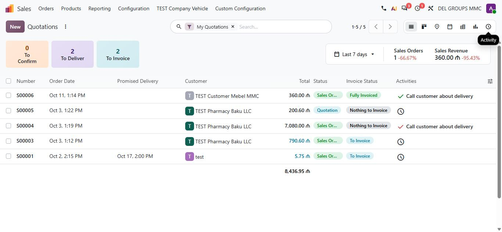
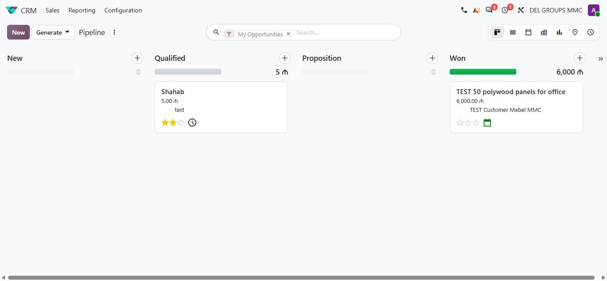
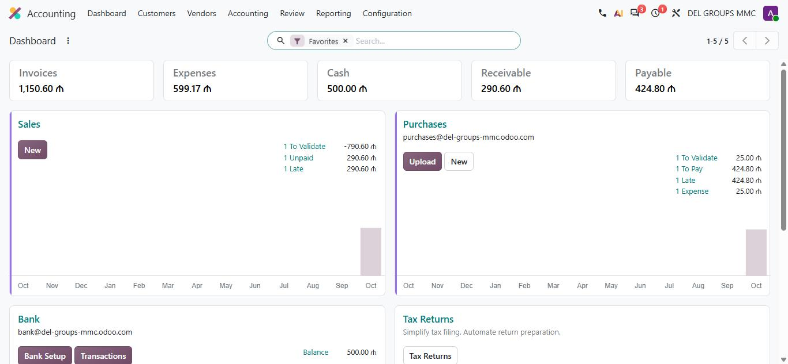
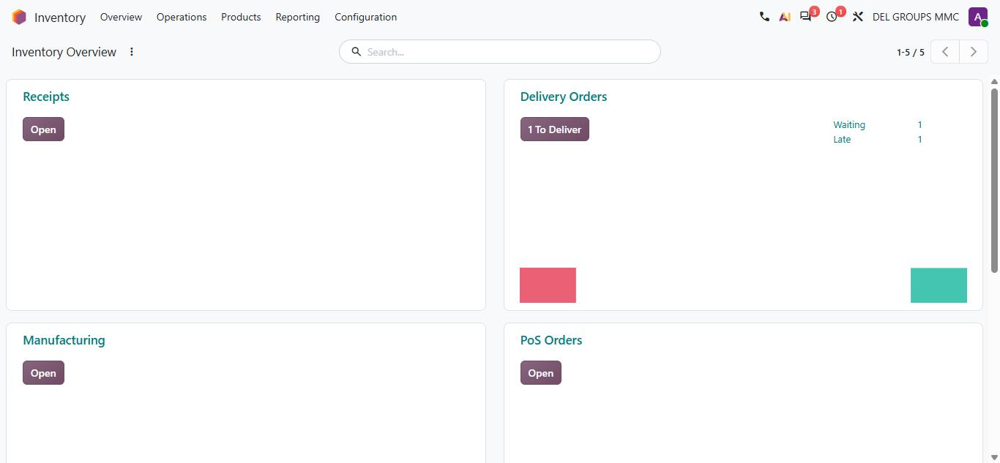
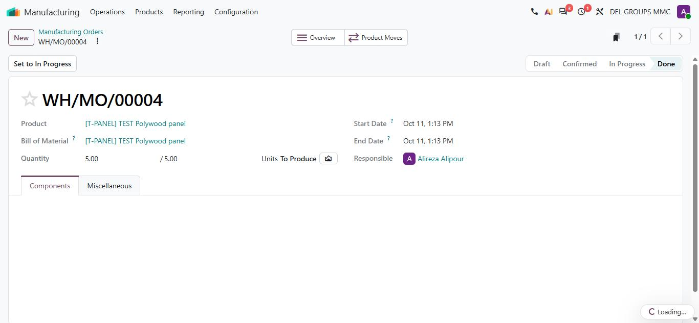
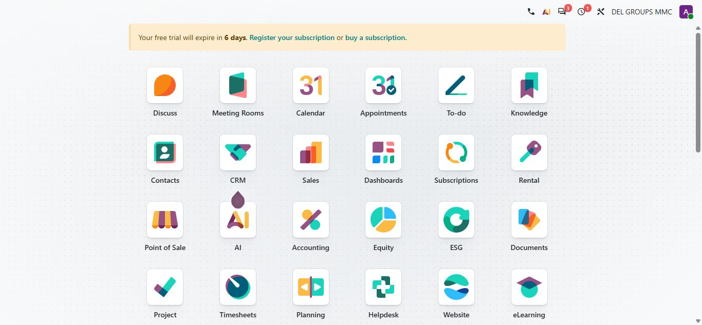

# گزارش ساختاری Odoo برای بازسازی ERP

> تاریخ: 2026-10-11 · منبع: دیتابیس آزمایشی `del-groups-mmc.odoo.com` (Odoo **20.0+e**، Enterprise، trial)
> مرتبط با: `docs/SaaS-Commercialization-Plan.md` بخش ۵، ۶ و ۸ و پرامپت ۱۴ در `docs/claude-code-prompts.md`
> ضمیمه‌ها: [منوی همه اپ‌ها](Odoo-Structural-Report-Appendix-Menus.md) · [مدل‌های کلیدی](Odoo-Structural-Report-Appendix-Models.md) · تصاویر در `docs/odoo-report-assets/`

**مرز قانونی:** این گزارش فقط مفهوم، ساختار و جریان کار را ثبت می‌کند. هیچ کد، متن، آیکون یا برند Odoo کپی نشده است. نام فنی مدل‌ها (مثل `sale.order`) فقط برای ارجاع آمده است.

---

## ۰. خلاصه در یک نگاه

1. **Odoo یک «موتور» است، نه مجموعه‌ای از صفحه‌ها.** هر اپ فقط سه چیز تعریف می‌کند: مدل (جدول + فیلد + منطق)، view (توصیف XML از List/Form/Kanban/…)، و منو → action. صفحه‌ها را یک کلاینت عمومی از روی متادیتا می‌سازد. برای ما یعنی **موتور View و رجیستری مدل** (پرامپت‌های ۴ و ۱۷) مهم‌ترین سرمایه‌گذاری است، نه بازنویسی تک‌تک صفحه‌ها.
2. **چند «mixin» مشترک همه‌جا تکرار می‌شوند:** Chatter (پیام و تاریخچه تغییرات)، Activities (کارهای زمان‌دار)، چندشرکتی، توزیع تحلیلی (analytic)، و نوار وضعیت. اکثر مدل‌های اصلی (۴۱ از ۵۰ مدلی که بررسی شد) Chatter دارند. این‌ها باید **در هسته ما** ساخته شوند، نه در هر ماژول.
3. **زنجیره اسناد:** هر سند سند بعدی را خودکار می‌سازد (سفارش خرید → رسید انبار → قبض خرید → پرداخت؛ سفارش فروش → حواله → فاکتور → پرداخت؛ BoM → سفارش تولید → حرکت انبار). ارتباط‌ها با «دکمه‌های هوشمند» بالای فرم نمایش داده می‌شوند.
4. **یک مدل برای چند اپ:** To-do همان کار پروژه بدون پروژه است؛ Subscriptions و Rental همان سفارش فروش با پرچم اضافه؛ Timesheet همان سطر تحلیلی حسابداری. این الگو تعداد جدول‌ها را کم نگه می‌دارد.
5. **نتیجه برای ما:** در هسته فروش، انبار، تولید و حسابداری ما (مخصوصاً منطق 1C، امانی، پلی‌وود، کمیسیون و مالیات آذربایجان) از Odoo جلوتر یا هم‌سطح هستیم. بزرگ‌ترین کمبودها **زیرساخت عمومی** است: Chatter/Activities، تقویم، موتور View با Pivot/Graph/Kanban، تنظیمات قابل نصب، و اپ‌های پیرامونی (CRM کامل، Documents، Approvals، Helpdesk، Project). جدول کامل در بخش ۷.

---

## ۱. روش کار و محیط

| مورد | مقدار |
|---|---|
| نسخه | Odoo 20.0+e (Enterprise)، دیتابیس trial با ۶ روز اعتبار باقی‌مانده |
| اپ‌های نصب‌شده | ۳۰ اپ از قبل + ۳۱ اپ که در این بررسی نصب شد (Purchase، Helpdesk، Fleet، Recruitment، Appraisals، Attendances، Timesheets، Repairs، Subscriptions، Rental، Quality، Maintenance، eCommerce، ESG، Data Cleaning، Referrals، Lunch، Frontdesk، Live Chat، Marketing Automation، Social، Events، eLearning، WhatsApp، Phone، Field Service، Meeting Rooms، Equity، AI و …). کانکتورهای مارکت‌پلیس (Amazon، Shopee …)، IoT و ماژول‌های کشوری نصب نشدند. |
| روش | ۱) خواندن ساختار از API داخلی خود Odoo (فقط خواندن متادیتا: منو، action، مدل، فیلد، view، cron، گروه دسترسی). ۲) اجرای جریان‌های واقعی یک شرکت با داده آزمایشی (همه رکوردها با پیشوند `TEST`). ۳) گرفتن تصویر از viewهای کلیدی. |
| داده آزمایشی | ۲ طرف‌حساب، ۳ محصول، ۱ BoM، ۱ خرید، ۱ تولید، ۱ Lead/فرصت، ۱ فروش، ۱ کارمند، مرخصی، حضور، هزینه، پروژه با ۲ کار و timesheet، جلسه، to-do، سند، درخواست تأیید، تیکت، تجهیزات و درخواست نگه‌داری، خودرو. داده‌ای حذف نشد. |

### اندازه پلتفرم (شمارش واقعی در همین دیتابیس)

| شیء | تعداد | معنی برای ما |
|---|---|---|
| ماژول نصب‌شده (فنی) | 588 | هر «اپ» از ده‌ها ماژول کوچک ساخته شده (پل‌های بین اپ‌ها مثل `sale_stock`، `sale_project`) |
| مدل | 1,271 | |
| فیلد | 29,531 | |
| منو | 1,192 | |
| Window action | 1,301 | هر منو به یک action اشاره می‌کند که مدل + viewها + دامنه + context را مشخص می‌کند |
| View | 6,631 | form 877، list 662، search 467، kanban 246، graph 131، pivot 123، calendar 42، activity 31، gantt 19، cohort 9، map 8، hierarchy 7، grid 4، qweb (قالب گزارش/وب) 1,322 |
| Server action | 485 | منطق قابل صدا زدن از منو یا اتوماسیون |
| گزارش PDF | 80 | |
| Cron فعال | 114 | کارهای زمان‌بندی‌شده (لیست در بخش ۲.۷) |
| گروه دسترسی | 183 | |
| قالب ایمیل | 112 | |
| نوع فعالیت | 18 | |

---

## ۲. معماری پلتفرم (هسته‌ای که همه اپ‌ها روی آن ساخته شده‌اند)

### ۲.۱ زنجیره منو → Action → View

```
منو (ir.ui.menu)  ──►  Action (مدل + view_mode + domain + context)
                           │
                           ├─► List view   (ستون‌ها، جمع، گروه‌بندی، ویرایش درجا)
                           ├─► Kanban view (ستون بر اساس stage، کارت، drag)
                           ├─► Form view   (header: دکمه‌ها + statusbar | button_box: دکمه‌های هوشمند | sheet | chatter)
                           ├─► Pivot / Graph / Cohort (گزارش روی همان مدل)
                           ├─► Calendar / Gantt / Map / Grid / Hierarchy / Activity
                           └─► Search view (فیلترها، group by، علاقه‌مندی‌ها)
```

- هر اپ چند «action» روی **همان مدل** با دامنه متفاوت دارد. مثال: Quotations و Orders هر دو روی `sale.order` با فیلتر متفاوت؛ در Subscriptions سه منو (Subscriptions، To Renew، Upsells) باز هم همان مدل.
- `view_mode` ترتیب viewها را مشخص می‌کند. فروش: `list,kanban,form,calendar,pivot,graph,activity,map`.
- **پیشنهاد برای ما:** در `manifest.ts` هر ماژول، به‌جای فهرست route، فهرست action تعریف شود: `{ id, model, views: [...], domain, defaultFilters, defaultGroupBy }`. موتور View صفحه را می‌سازد.

### ۲.۲ الگوهای مشترک مدل (mixin)

از ۵۰ مدل اصلی که بررسی شد:

| قابلیت | تعداد مدل | کار |
|---|---|---|
| Chatter (`message_ids`، دنبال‌کننده‌ها، tracking) | 45 | یادداشت داخلی، پیام به مشتری، تاریخچه خودکار تغییر فیلدها (مثلاً «سفارش تأیید شد» به‌صورت پیام نوع tracking ثبت شد) |
| Activities (`activity_ids`) | 37 | کار زمان‌دار روی رکورد با نوع (To-Do، Email، Call، Meeting، Upload document، Signature request …)، مسئول و مهلت؛ وضعیت overdue/today/planned |
| چندشرکتی (`company_id`) | 42 | |
| توزیع تحلیلی (`analytic_distribution`) | 6 (سطر فروش، سطر سند حسابداری، سطر تحلیلی و timesheet، کارمند، نسخه کارمند، هزینه) | تقسیم مبلغ بین چند مرکز هزینه به درصد |
| Rating | تقریباً همه | امتیاز مشتری روی تیکت، کار پروژه، … |
| فیلد سفارشی Studio (`x_…`) | sale.order، analytic line | فیلد و حتی مدل سفارشی (`x_test_company_vehicle` در همین دیتابیس با Studio ساخته شده) |

**پیشنهاد برای ما:** سه جدول عمومی در هسته با کلید `(res_model, res_id)`:
`messages` (body، نوع: note/comment/tracking، نویسنده، پیوست)، `tracking_values` (فیلد، قدیم، جدید)، `activities` (نوع، مسئول، مهلت، وضعیت، summary)، به‌علاوه `followers`. هر ماژول فقط اعلام می‌کند کدام فیلدها tracking دارند. این همان پرامپت ۱۹ است و باید **قبل از** CRM و Calendar ساخته شود.

### ۲.۳ آناتومی فرم (الگوی ثابت در همه اپ‌ها)



1. **Breadcrumb** بالا چپ (Quotations / S00006) + منوی چرخ‌دنده (کپی، حذف، آرشیو، چاپ).
2. **دکمه‌های هوشمند** وسط بالا: شمارنده اسناد مرتبط (Delivery 1، Invoices 1). در مدل‌ها تا ۱۰ دکمه هوشمند دیدیم (مثلاً محصول: پیش‌بینی موجودی، خرید، فروش، اجاره، BoM، تولید، تغییرات مهندسی).
3. **Header:** دکمه‌های اقدام (Send، Preview، Cancel) که بسته به وضعیت عوض می‌شوند + **Statusbar** در راست (Quotation → Quotation Sent → Sales Order).
4. **Sheet:** عنوان بزرگ، فیلدها در دو ستون، badge وضعیت (Fully Delivered)، تب‌ها (Order Lines، Other Info، Notes).
5. **سطرها:** جدول قابل ویرایش درجا با Add Line / Add Section / Add Note / Catalog؛ ستون‌های Delivered و Invoiced کنار Quantity (وضعیت اجرای هر سطر).
6. **Chatter** در کنار یا پایین فرم (بسته به عرض صفحه).

### ۲.۴ آناتومی List و Kanban



- **کارت‌های KPI بالای لیست** (To Confirm / To Deliver / To Invoice) که با کلیک فیلتر می‌کنند، و یک باکس مقایسه دوره (Last 7 days با درصد تغییر).
- **سوئیچ view** در راست بالا (List، Kanban، Map، Calendar، Pivot، Graph، Activity).
- **جستجو با فیلتر به شکل chip** («My Quotations ×»)، شمارنده و صفحه‌بندی «1-5 / 5».
- ستون **Activities** با آیکون وضعیت و خلاصه فعالیت بعدی؛ badgeهای رنگی برای وضعیت؛ جمع ستون مبلغ در پایین؛ انتخاب ستون‌ها با آیکون تنظیم.



- ستون = stage؛ زیر عنوان ستون **نوار پیشرفت** و جمع درآمد مورد انتظار؛ دکمه + برای ایجاد سریع در همان ستون؛ کارت با مبلغ، مشتری، ستاره اولویت و آیکون فعالیت.

### ۲.۵ داشبوردها




- داشبورد = **Kanban روی مدل پیکربندی** (حسابداری روی دفاتر `account.journal`، انبار روی نوع عملیات `stock.picking.type`، تولید روی مرکز کار، Helpdesk روی تیم). هر کارت شمارنده‌های قابل کلیک (To Validate، Unpaid، Late، Waiting) و یک نمودار کوچک دارد. یعنی داشبورد هم از همان موتور View ساخته شده است.
- اپ Dashboards جداگانه روی Spreadsheet کار می‌کند (داشبوردهای قابل ویرایش با فرمول).

### ۲.۶ امنیت

- **گروه‌ها** به‌صورت سطح در هر اپ: «User: Own Documents Only → User: All Documents → Administrator» (فروش)، «Read-only → Invoicing → Invoicing & Banks → Bookkeeper → Administrator» (حسابداری). ۱۸۳ گروه که حدود نیمی از آن‌ها «گروه قابلیت» هستند (مثلاً Manage Lots / Serial Numbers، Multi Currencies، Analytic Accounting) و با تیک در Settings روشن می‌شوند.
- لایه‌ها: دسترسی مدل (CRUD برای هر گروه) + قانون رکورد (domain، مثلاً «فقط اسناد خودم») + دسترسی فیلد (`groups` روی فیلد/view).
- **پیشنهاد:** ماتریس دسترسی ما (`permissionMatrix.ts`) را به همین سه لایه ببریم و «گروه قابلیت» را همان تنظیمات ماژول بدانیم.

### ۲.۷ اتوماسیون و کارهای زمان‌بندی‌شده

۱۱۴ cron فعال. نمونه‌هایی که برای ما مفهوم دارند:

| حوزه | کار |
|---|---|
| حسابداری | ارسال خودکار سند پیش‌نویس با تاریخ رسیده، بستن ارزش‌گذاری موجودی روزانه، به‌روزرسانی نرخ ارز روزانه، تطبیق خودکار صورت‌حساب بانک، ساخت اظهارنامه مالیاتی دوره‌ای، ارسال خودکار فاکتور و گزارش |
| انبار/خرید | Procurement scheduler (حداقل موجودی و قوانین تأمین)، یادآوری خرید |
| فروش | صدور فاکتور تکراری اشتراک‌ها، انقضا و یادآوری |
| منابع انسانی | محاسبه مرخصی تجمعی، check-out خودکار حضور، تشخیص غیبت، هشدار قرارداد/اجازه کار رو به انقضا، اعمال خروج کارمند، ارزیابی دوره‌ای |
| عمومی | صف ایمیل (ساعتی)، یادآور تقویم، پیام زمان‌بندی‌شده، پاک‌سازی و ادغام رکورد تکراری، OCR فاکتور/هزینه/رزومه، AI embedding |

- **Automation rules** (`base.automation`): قانون «وقتی رکورد ساخته/عوض شد یا تاریخ رسید → اکشن» که کاربر بدون کد می‌سازد. در این دیتابیس ۲ قانون وجود دارد.
- **پیشنهاد:** `erp_events` موجود ما پایه خوبی برای همین است؛ یک جدول `automation_rules` (trigger: on_create/on_write/on_time + domain + action: set field/create activity/send email/webhook) و یک scheduler در هسته.

### ۲.۸ شماره‌گذاری و گزارش PDF

- شماره سند با `ir.sequence` و پیشوند انبار/سال: `P00001`، `WH/IN/00002`، `WH/MO/00004`، `S00006`، `WH/OUT/00004`، `INV/2026/00002`، `BILL/2026/10/0002`. (ما `document_number_counters` را داریم که معادل است.)
- گزارش‌های PDF برای هر مدل (مثلاً فروش: Quotation/Order، Pro-forma، Pickup and Return Receipt، Timesheets؛ انبار: Delivery Slip، Picking Operations، Packages، Return slip، Shipping Labels؛ حقوق: Payslip و Payslip Light). قالب‌ها QWeb هستند و layout شرکت (لوگو، هدر، فوتر) را مشترک استفاده می‌کنند.

### ۲.۹ تنظیمات

- همه تنظیمات اپ‌ها در یک مدل موقتی (`res.config.settings`) و یک صفحه Settings با بخش هر اپ است. تیک یک قابلیت = فعال شدن گروه قابلیت یا نصب ماژول پل (مثلاً تیک «Lots & Serial Numbers»).
- **پیشنهاد:** تنظیمات هر ماژول در manifest (`settings: [...]`) تعریف شود و صفحه Settings از رجیستری ساخته شود؛ همان چیزی که برنامه ۵.۱ گفته است.

---

## ۳. اپ‌ها: کاتالوگ ساختاری

ستون «مدل‌های اصلی» نام فنی Odoo است؛ «Views» نوع viewهای منوی اصلی. فهرست کامل منوها در [ضمیمه منوها](Odoo-Structural-Report-Appendix-Menus.md) و فیلدها، وضعیت‌ها و دکمه‌ها در [ضمیمه مدل‌ها](Odoo-Structural-Report-Appendix-Models.md).

### ۳.۱ فروش و مشتری

| اپ | مدل‌های اصلی | وضعیت / مرحله | Views | نکات ساختاری |
|---|---|---|---|---|
| **Contacts** | `res.partner` (شرکت + اشخاص زیرمجموعه با `parent_id`)، تگ، صنعت، حساب بانکی | — | list, kanban, form, hierarchy, activity | یک جدول برای مشتری، تأمین‌کننده، کارمند (work contact) و کاربر؛ نقش از روی اسناد مشخص می‌شود. حساب دریافتنی/پرداختنی، شرط پرداخت و fiscal position روی طرف‌حساب. ۱۰ دکمه هوشمند (فرصت، فروش، POS، فاکتور، follow-up، اشتراک، رویداد، جلسه، کار) |
| **CRM** | `crm.lead` (Lead و Opportunity در یک مدل با `type`)، `crm.stage`، `crm.team`، `crm.lost.reason`، `crm.tag` | stage (New → Qualified → Proposition → Won) + priority ۰–۳ + probability | kanban, list, graph, pivot, calendar, activity, cohort | تبدیل Lead به Opportunity، Won/Lost با دلیل، احتمال خودکار (۵۰٪ در New، ۱۰۰٪ در Won)، درآمد تکراری (recurring plan)، UTM (campaign/source/medium)، گزارش Forecast و Pipeline. از فرم: New Quotation، New Rental، Convert to Ticket |
| **Sales** | `sale.order`، `sale.order.line`، `product.pricelist`، `sale.order.template`، `sale.report` (view گزارشی) | `state`: draft → sent → sale → cancel؛ `invoice_status`: no / to invoice / invoiced / upselling | list, kanban, form, calendar, pivot, graph, activity, map | قالب پیش‌فاکتور، Header/Footer PDF، تحویل جزئی، سیاست فاکتور (سفارش‌شده/تحویل‌شده)، قفل سفارش تأییدشده، تخفیف سطر، حمل. سطر فروش به حرکت انبار، خرید، پروژه/کار، رویداد، هزینه و timesheet وصل می‌شود |
| **Subscriptions** | همان `sale.order` + `sale.subscription.plan`، `sale.order.log` | + وضعیت اشتراک | + cohort | MRR Breakdown/Timeline، Retention (cohort)، تمدید و upsell، صدور فاکتور تکراری با cron |
| **Rental** | همان `sale.order` + `sale.rental.report` | pickup/return | + gantt روی سطرها | زمان‌بندی اجاره با Gantt روی سطرهای سفارش |
| **Point of Sale** | `pos.config`، `pos.session`، `pos.order`، `pos.payment`، `pos.payment.method`، `pos.prep.display` | سفارش: draft → paid → done | kanban, list, form, pivot | جلسه صندوق با باز و بسته کردن، روش پرداخت، نمایشگر آشپزخانه، combo، فاکتور خودکار |
| **eCommerce / Website** | `website`، `product.public.category`، `website.visitor`، `sale.order` (سبد رها‌شده) | — | | فروشگاه روی همان محصول و سفارش فروش |

### ۳.۲ زنجیره تأمین و تولید

| اپ | مدل‌های اصلی | وضعیت | Views | نکات ساختاری |
|---|---|---|---|---|
| **Purchase** | `purchase.order`، `purchase.order.line`، `product.supplierinfo` (قیمت تأمین‌کننده) | draft (RFQ) → sent → to approve → purchase → cancel | list, kanban, form, pivot, graph, calendar, activity | تأیید دو مرحله‌ای بالای مبلغ مشخص، Lock، مقایسه پیشنهادها، تطبیق قبض با سفارش (bill matching)، Bills To Receive / Billed Not Received در حسابداری |
| **Inventory** | `stock.warehouse`، `stock.location` (درختی با `usage`: internal/supplier/customer/production/inventory…)، `stock.picking.type`، `stock.picking`، `stock.move`، `stock.move.line`، `stock.quant`، `stock.route`، `stock.rule`، `stock.lot`، `stock.package`، `stock.warehouse.orderpoint` | picking و move: draft → waiting → confirmed → (partially_)assigned → done → cancel | kanban (overview), list, form, pivot, graph | **مدل دوطرفه:** هر حرکت از یک location به location دیگر است؛ موجودی (`quant`) نتیجه حرکت‌هاست. انبار چندمرحله‌ای (دریافت ۱/۲/۳ مرحله، ارسال ۱/۲/۳ مرحله)، Route و Rule (pull/push، MTO، تأمین مجدد)، Batch/Wave، رزرو، backorder، بازگشت، اسکرپ، شمارش فیزیکی، putaway، lot/serial، بسته‌بندی |
| **Barcode** | (client action روی picking) | | | اسکن برای رسید، ارسال، شمارش |
| **Manufacturing** | `mrp.bom` (+ سطر، محصول جانبی، عملیات)، `mrp.production`، `mrp.workorder`، `mrp.workcenter`، `mrp.routing.workcenter`، `mrp.unbuild` | MO: draft → confirmed → progress → to_close → done؛ workorder: blocked → ready → progress → done | list, kanban, form, gantt, calendar, pivot, graph | مصرف مواد و تولید محصول به‌صورت `stock.move`، دسترس‌پذیری مواد، Work Order با تایمر، OEE، Unbuild، زیرسفارش (child MO)، Shop Floor (تبلت کارگاه) |
| **PLM** | `mrp.eco` (درخواست تغییر مهندسی)، نوع و مرحله ECO | confirmed → progress → rebase/conflict → done + stage | kanban, list, form | نسخه‌بندی BoM با مقایسه و تأیید چندنفره |
| **Quality** | `quality.point` (نقطه کنترل)، `quality.check`، `quality.alert`، تیم | check: pass/fail | kanban, list, form, pivot, graph | نوع تست: instructions، picture، pass/fail، measure، spreadsheet، ثبت مصرف/تولید، چاپ برچسب. نقطه کنترل روی نوع عملیات انبار یا عملیات تولید |
| **Maintenance** | `maintenance.equipment`، `maintenance.request`، تیم، دسته | stage (New Request → …) + state | kanban, list, form, gantt, calendar | نگه‌داری پیشگیرانه/اصلاحی، برنامه‌ریزی روی تجهیزات یا مرکز کار |
| **Repairs** | `repair.order`، سطر خدمات | draft → confirmed → done | | قطعات به‌صورت حرکت انبار، صدور پیش‌فاکتور و فاکتور |



### ۳.۳ مالی

| اپ | مدل‌های اصلی | وضعیت | نکات ساختاری |
|---|---|---|---|
| **Accounting / Invoicing** | `account.move` (فاکتور، قبض، اعتبار، سند دستی در **یک** مدل با `move_type`)، `account.move.line`، `account.payment`، `account.journal`، `account.account`، `account.tax`، `account.fiscal.position`، `account.payment.term`، `account.analytic.*`، `account.asset`، `account.loan`، `account.report`، `account.bank.statement.line` | move: draft → posted → cancel؛ `payment_state`: not_paid → partial → in_payment → paid / reversed؛ payment: draft → paid → reconciled | فاکتور = سند حسابداری؛ سطرهای فاکتور همان سطرهای دفتر هستند. پرداخت ابتدا به «حساب در جریان» می‌رود و وضعیت فاکتور `in_payment` است تا با صورت‌حساب بانک تطبیق شود، بعد `paid`. گزارش‌ها: ترازنامه، سود و زیان، جریان نقد، دفتر کل، تراز آزمایشی، دفتر طرف‌حساب، سنی بدهی/طلب، اظهارنامه مالیاتی، Executive Summary. بستن دوره با Lock Dates، Audit Trail، درآمد/هزینه معوق، ارزش‌گذاری موجودی، چنددفتری (Multi-Ledger)، بودجه، تطبیق بانک آنلاین |
| **Expenses** | `hr.expense` | draft → submitted → approved → posted → in_payment → paid / refused | پرداخت توسط کارمند (بازپرداخت) یا شرکت، OCR رسید، تقسیم هزینه، اتصال به فروش (re-invoice) و فیش حقوقی |
| **Equity** | تراکنش سهام، ارزش‌گذاری، UBO، کلاس سهام | | Cap Table |
| **ESG** | انتشار کربن، فاکتور انتشار، شاخص‌ها، گزارش CSRD/VSME | | |

### ۳.۴ منابع انسانی

| اپ | مدل‌های اصلی | وضعیت | نکات ساختاری |
|---|---|---|---|
| **Employees** | `hr.employee`، **`hr.version`** (نسخه قرارداد/شرایط کارمند)، `hr.department`، `hr.job`، `resource.calendar`، مهارت و رزومه | — | در Odoo 20 قرارداد جدا حذف شده و هر تغییر شرایط (حقوق، شغل، دپارتمان، برنامه کاری) یک **نسخه تاریخ‌دار** است؛ ساخت کارمند خودکار نسخه اول را ساخت. Onboarding/Offboarding با Activity Plan، پوشه Documents خودکار برای هر کارمند |
| **Time Off** | `hr.leave`، `hr.leave.allocation`، `hr.leave.accrual.plan`، تعطیلات | confirm → validate1 → validate / refuse / cancel | **بدون تخصیص (allocation) مرخصی ثبت نمی‌شود** (تست کردیم: خطا داد؛ بعد از تخصیص ۲۰ روز، مرخصی ۲ روزه ثبت و تأیید شد). تأیید یک یا دو مرحله‌ای، تخصیص تجمعی |
| **Attendances** | `hr.attendance` | draft → validated → refused | ورود/خروج، Kiosk، اضافه‌کار، قوانین زمانی خودکار |
| **Payroll** | `hr.payslip`، `hr.payslip.run`، `hr.payroll.structure`، `hr.salary.rule`، `hr.rule.parameter`، `hr.work.entry.type` | draft → validated → paid → cancel | قوانین حقوق **وابسته به کشور** است. در این دیتابیس هیچ ساختار حقوقی وجود ندارد (بسته آذربایجان ندارد)، پس فیش ساخته شد ولی محاسبه‌ای انجام نشد. مزیت ما: موتور مالیات و حقوق آذربایجان (`settings/tax-payroll`) را داریم |
| **Recruitment / Referrals** | `hr.applicant`، `hr.job`، مرحله، talent pool | stage + kanban_state | |
| **Appraisals** | `hr.appraisal`، هدف، قالب، 360 feedback با Survey | 1_new → 2_pending → 3_done | |
| **Fleet** | `fleet.vehicle`، قرارداد، سرویس، کیلومتر | state_id (stage) | راننده هم partner و هم employee؛ هزینه‌ها از سطر قبض خرید |
| **Lunch / Frontdesk** | | | ناهار و پذیرش مهمان |

### ۳.۵ خدمات و بهره‌وری

| اپ | مدل‌های اصلی | وضعیت | نکات ساختاری |
|---|---|---|---|
| **Project** | `project.project`، `project.task`، `project.task.type` (stage)، milestone، update | task.state: in_progress / changes_requested / approved / done / canceled / waiting + stage | زیرکار با `parent_id`، وابستگی کار، تکرار، ساعت تخصیصی و پیشرفت از timesheet (تست: ۴ ساعت تخصیص، ۲.۵ ساعت ثبت → ۶۲٪). مرحله‌های پیش‌فرض: New / In Progress / Done / Cancelled. Views: kanban, list, form, gantt, calendar, map, activity, pivot, graph |
| **To-do** | **همان `project.task`** بدون پروژه + مرحله شخصی (`personal_stage_type_id` = Inbox) | | مدل جدا لازم نیست |
| **Timesheets** | **همان `account.analytic.line`** با employee و task | validated_status | Grid view هفتگی، تأیید، دستیار، هدف ساعت قابل فاکتور |
| **Planning / Field Service** | `planning.slot`، نقش، قالب شیفت | 1_draft → 2_published → 3_in_progress → 4_completed | Gantt بر اساس منبع/نقش/سفارش فروش، نقشه زنده |
| **Helpdesk** | `helpdesk.ticket`، تیم، stage، SLA | stage + kanban_state + priority | شماره تیکت، SLA، تیکت مشابه با AI، تبدیل از Lead یا Live chat، Plan Intervention |
| **Calendar / Appointments / Meeting Rooms** | `calendar.event`، `calendar.attendee`، `calendar.recurrence`، `appointment.type`، `room.booking` | | رویداد به رکورد (`res_model`/`res_id`) و به فرصت، متقاضی، سفارش وصل می‌شود؛ تکرار؛ یادآور؛ رزرو آنلاین |
| **Discuss** | `discuss.channel`، تاریخچه تماس | | کانال، پیام مستقیم، تماس صوتی/تصویری |
| **Knowledge** | `knowledge.article` (درختی، عضو، علاقه‌مندی، stage) | | Views: list, kanban, **hierarchy**, form |
| **Documents** | `documents.document` (فایل و پوشه در **یک** مدل با `type`)، تگ، دسترسی | | پوشه خودکار برای هر پروژه و کارمند (دیدیم)، درخواست سند به‌صورت Activity، Spreadsheet، AI برای مرتب‌سازی |
| **Sign** | `sign.template`، `sign.request` | shared → sent → signed / canceled / expired | |
| **Approvals** | `approval.category`، `approval.request`، `approval.approver` | new → pending → approved / refused | دسته‌ها: سفر کاری، امانت گرفتن، عمومی، قرارداد، درخواست پرداخت، اجاره خودرو، خرید (که مستقیم RFQ می‌سازد). **حداقل یک تأییدکننده لازم است** (تست کردیم) |
| **Data Cleaning** | قانون ادغام تکراری، بازیافت، تمیزکاری فیلد | | |
| **AI** | `ai.agent`، `ai.skill`، ابزار (server action) | | |

### ۳.۶ بازاریابی و وب

Email/SMS Marketing، Marketing Automation، Social Marketing، Events، Surveys، eLearning، Live Chat، WhatsApp، Link Tracker، Marketing Card. ساختار مشترک: `mailing.mailing`، لیست مخاطب، `utm.campaign/source/medium` که در CRM و فروش و استخدام هم استفاده می‌شود. این گروه برای ما اولویت ۴ است (بعد از پایلوت).

---

## ۴. جریان‌های اجرا شده (مثل یک شرکت واقعی)

| # | جریان | نتیجه مشاهده‌شده |
|---|---|---|
| 1 | محصول + BoM | ۳ محصول انباری (تخته، چسب، پنل پلی‌وود)؛ BoM پنل = ۲ تخته + ۱ چسب |
| 2 | خرید → رسید → قبض → پرداخت | تأیید `P00001` خودکار رسید `WH/IN/00002` ساخت. بعد از ثبت مقدار، رسید done شد. قبض از روی سفارش ساخته شد (`BILL/2026/10/0002`، 450). پرداخت → `in_payment` |
| 3 | تولید | `WH/MO/00004` برای ۵ پنل؛ مواد Available؛ بعد از done: پنل 5، تخته 10 (از 20)، چسب 5 (از 10). مصرف و تولید همه به‌صورت حرکت انبار |
| 4 | Lead → فرصت → پیش‌فاکتور → فروش | Lead به Opportunity تبدیل شد (stage New، احتمال 50٪). سفارش `S00006` با لینک به فرصت ساخته و تأیید شد؛ تأیید **خودکار حواله `WH/OUT/00004`** ساخت. Won → احتمال 100٪ |
| 5 | حواله → فاکتور → پرداخت | حواله done؛ فاکتور با ویزارد «بر اساس مقدار تحویل‌شده» (`INV/2026/00002`، 360). سند: بستانکار فروش 360 / بدهکار دریافتنی 360. پرداخت → `in_payment`؛ وضعیت سفارش `invoiced`. هیچ سند ارزش‌گذاری موجودی همزمان با حواله ساخته نشد (به نظر Odoo 20 ارزش‌گذاری را با cron روزانه «Inventory Valuation Closing» ثبت می‌کند؛ این استنباط است) |
| 6 | Chatter | روی سفارش: یک پیام tracking «Sales Order Confirmed»، یادداشت داخلی، و یک Activity با مهلت |
| 7 | کارمند | ساخت کارمند خودکار نسخه `hr.version` ساخت؛ پوشه Documents کارمند ساخته شد |
| 8 | مرخصی | بدون تخصیص رد شد؛ بعد از تخصیص 20 روز، 2 روز ثبت و تأیید شد |
| 9 | هزینه | ثبت، ارسال و تأیید (approved، 25) |
| 10 | حقوق | فیش ساخته شد ولی ساختار حقوقی برای کشور تعریف نشده بود، پس سطر محاسبه‌ای ندارد |
| 11 | پروژه | پروژه برای مشتری، کار با زیرکار، 2.5 ساعت timesheet؛ پوشه Documents پروژه خودکار ساخته شد |
| 12 | تقویم، To-do، سند، تأیید، تیکت، نگه‌داری، خودرو | همه ساخته شدند. To-do = کار بدون پروژه. تأیید بدون تأییدکننده رد شد. تیکت شماره `00001` گرفت. درخواست نگه‌داری خودکار تیم پیش‌فرض گرفت |

---

## ۵. الگوهای UI/UX

### ارزش نگه‌داشتن

1. **App Launcher** (شبکه آیکون اپ‌ها، تصویر ۱) و نوار بالای هر اپ با منوهای همان اپ.
2. **Statusbar + دکمه‌های وابسته به وضعیت** در هر سند.
3. **دکمه‌های هوشمند** برای پیمایش زنجیره اسناد بدون جستجو.
4. **Breadcrumb** که مسیر را بین اسناد مرتبط حفظ می‌کند.
5. **Chatter و Activity** کنار هر سند.
6. **سوئیچ view** روی همان داده و فیلترهای chip قابل ذخیره.
7. **KPIهای قابل کلیک** بالای لیست که خودشان فیلترند.
8. **ویرایش درجای سطرها** با Section و Note.
9. **داشبورد kanban** روی پیکربندی (دفاتر، انبارها، تیم‌ها).



### جایی که می‌توانیم بهتر باشیم

1. **سرعت:** در تست‌ها صفحه‌ها (Inventory، Accounting، Project) چند ثانیه خالی بودند تا داده برسد. ما با skeleton، prefetch و cache سمت کلاینت (React Query موجود) می‌توانیم حس سریع‌تری بدهیم.
2. **فرم‌های شلوغ:** `res.partner` ۳۱۲ فیلد، `sale.order` ۲۵۷ فیلد دارد و تب‌ها پر هستند. ما می‌توانیم با «حالت ساده/پیشرفته» و نمایش فیلد بر اساس نقش، فرم‌ها را خلوت‌تر کنیم.
3. **داشبورد واقعی:** داشبوردهای Odoo بیشتر شمارنده و نمودار ستونی ساده‌اند. اینفوگراف‌های برنامه ۶.۲ (قیفی، heatmap، Sankey، گیج) و KPI زنده زیر هر آیکون launcher مزیت ماست.
4. **موبایل:** فرم در عرض کم فشرده است و Chatter پایین می‌افتد. طراحی موبایل‌اول برای انبار و فروش میدانی.
5. **زبان و تقویم محلی:** RTL، آذری/روسی/فارسی و فرمت عدد و ارز ₼ از روز اول.
6. **پیام خطا:** خطاهای قانون کسب‌وکار (مثلاً «تخصیص مرخصی ندارید»، «حداقل یک تأییدکننده») فقط بعد از ذخیره نمایش داده می‌شوند؛ ما می‌توانیم قبل از ذخیره در فرم راهنمایی کنیم.

---

## ۶. درس‌های معماری برای ERP ما

| # | تصمیم | دلیل از Odoo | کجا در برنامه |
|---|---|---|---|
| 1 | **رجیستری مدل در هسته:** هر ماژول مدل‌هایش را با فیلد، نوع، وضعیت، فیلدهای tracking و mixinها اعلام کند | همه viewها، جستجو، دسترسی، Studio و گزارش از متادیتای مدل ساخته می‌شوند | پرامپت ۴ و ۱۷ |
| 2 | **Action به‌جای صفحه:** منو → action (مدل + viewها + دامنه + فیلتر پیش‌فرض) | چند منو روی یک مدل بدون کد جدید | پرامپت ۴، ۱۶، ۱۷ |
| 3 | **Chatter، Activity، Follower، Attachment، Tracking در هسته** با `(res_model, res_id)` | ۴۱ از ۵۰ مدل اصلی Chatter و ۳۷ مدل Activity دارند | پرامپت ۱۹ (قبل از ۲۰–۲۳) |
| 4 | **مدل یکپارچه سند حسابداری:** فاکتور فروش، قبض خرید، اعتبار و سند دستی همه یک جدول با نوع | گزارش‌ها و تطبیق یک‌جا | فعلاً `journal_entries` + فروش/خرید جدا داریم؛ بازطراحی لازم نیست ولی لایه «سند واحد» برای گزارش‌گیری مفید است |
| 5 | **حرکت انبار location به location** و موجودی به‌عنوان نتیجه | انبار چندمرحله‌ای، تولید، اسکرپ و امانی همه یک مفهوم می‌شوند | ما `stock_movements` و `warehouse_stocks` داریم؛ مدل location (از جمله «مشتری»، «تولید»، «امانی») را می‌توان اضافه کرد |
| 6 | **پل‌های بین ماژول** (مثل `sale_stock`) به‌جای import مستقیم | نصب‌نبودن یک ماژول چیزی را نمی‌شکند | همان `erp_events` و hook در برنامه ۵.۳ |
| 7 | **To-do = کار بدون پروژه، Timesheet = سطر تحلیلی** | جدول کمتر | پرامپت ۲۲ و Project |
| 8 | **نسخه‌بندی شرایط کارمند** به‌جای ویرایش مستقیم | تاریخچه حقوق و شغل | ماژول HR |
| 9 | **گروه قابلیت = تنظیمات ماژول** | Settings یکپارچه | پرامپت ۵ و ۱۲ |
| 10 | **Automation rule و scheduler عمومی** | ۱۱۴ cron و قوانین بدون کد | بعد از Chatter |

---

## ۷. جدول Gap: Odoo در برابر ERP ما

مبنا: شاخه `main`، پوشه `src/app`، `src/lib` و جدول‌های تعریف‌شده در `supabase/migrations` و `types/*.sql`. وضعیت هر ردیف از روی نام صفحه‌ها، کتابخانه‌ها و جدول‌ها **استنباط** شده و باید هنگام کار روی هر ماژول دقیق‌تر بررسی شود.

| حوزه | Odoo | ما (مدرک) | وضعیت | اولویت پیشنهادی |
|---|---|---|---|---|
| طرف‌حساب | `res.partner` یکپارچه، شرکت/شخص، چند آدرس | `partners`، `suppliers`، `consignment_partners`؛ صفحات customers، suppliers، dashboard/partners | **جزئی** (جدول جدا برای تأمین‌کننده و امانی؛ اشخاص زیرمجموعه و چند آدرس ندیدیم) | ۲ |
| محصول | template/variant، ویژگی، واحد، قیمت‌گذاری، تأمین‌کننده | `products`، `categories`، `sub_categories`؛ products، damaged-goods، barcode | **جزئی** (variant و pricelist کامل ندیدیم؛ سطح قیمت هر سطر داریم) | ۳ |
| CRM | Lead/Opportunity، stage قابل تنظیم، تیم، دلیل باخت، forecast | `deals` با مرحله ثابت، `quotations`؛ صفحه crm و settings/crm | **جزئی** | ۱ (پرامپت ۲۱) |
| فروش | پیش‌فاکتور → سفارش → تحویل → فاکتور، قالب، قفل | `sales`، `sale_items`، `quotations`، draft/posted مثل 1C، `warehouse_slips`، فروش پلی‌وود، تخفیف و مانده فاکتور | **داریم** (مدل 1C: فاکتور مستقیم). وضعیت «سفارش قبل از فاکتور» و تحویل جزئی را جداگانه بررسی کنید | ۲ |
| اشتراک / اجاره | | — | **ندارد** | ۴ |
| POS | | — | **ندارد** | ۴ |
| خرید | RFQ → PO → رسید → قبض، تأیید دومرحله‌ای، قیمت تأمین‌کننده | `purchase_requests`، `purchases`، `purchase_items`، draft/posted، `supplier_delivery_ratings`، settings/procurement | **داریم** | ۳ |
| انبار | location درختی، route/rule، lot/serial، بسته، چندمرحله، شمارش، اسکرپ | `warehouses`، `warehouse_stocks`، `stock_movements`، `stock_transfers`، `inventory_counts`، `inventory_audits`، `inventory_batches` (FIFO)، `inventory_writeoffs`، موجودی اولیه | **داریم** (route/rule و lot/serial و چندمرحله‌ای را ندیدیم) | ۳ |
| امانی (Consignment) | (مفهوم «مالک موجودی» دارد) | ماژول کامل: dispatch، settlement، returns، گزارش ماهانه | **ما جلوتریم** | — |
| تولید | BoM، MO، Work Order، مرکز کار، OEE، Unbuild | `production_boms`، `production_orders`، `production_materials`، `production_contractors`، `production_outsourcing`، `production_expenses`، رزرو موجودی | **داریم** (Work Order/مرکز کار و Shop Floor را ندیدیم؛ پیمانکار و برون‌سپاری ما اضافه است) | ۳ |
| پلی‌وود | — | `polywood_pieces`، `polywood_inventory_items` | **مخصوص ما** | — |
| PLM / Quality / Maintenance / Repairs | | — | **ندارد** | ۳ |
| حسابداری | سند واحد، دفتر، مالیات، fiscal position، تطبیق بانک، گزارش‌های استاندارد، Lock date، دارایی، وام، بودجه | `chart_of_accounts`، `journal_entries`، `journal_entry_lines`، `accounting_periods`، `payments`، cash-bank، گزارش‌های OSV، reconciliation، inventory-turnover، `vatEngine.ts` | **جزئی** (پایه داریم؛ دارایی ثابت، تطبیق بانک خودکار، بودجه، چندارزی کامل را ندیدیم) | ۲ |
| مالیات آذربایجان | بسته کشوری لازم دارد | settings/tax-payroll، `src/lib/tax` | **ما جلوتریم** | — |
| هزینه | ثبت، تأیید، بازپرداخت، OCR | `expense_categories`، `expense_attachments`، صفحه expenses، `employee_advances` | **داریم** (OCR ندارد) | ۳ |
| کمیسیون | (ندارد؛ با Studio) | `commission_rules`، `sales_commissions`، `employee_commission_rules` | **ما جلوتریم** | — |
| قرارداد | (Sign + Documents) | `contracts`، `production_contracts` | **جزئی** (امضای الکترونیکی نداریم) | ۳ |
| کارمند | کارمند، نسخه قرارداد، دپارتمان، مهارت، onboarding | صفحه employees، `employee_departments`، `profiles` | **جزئی** | ۲ |
| مرخصی | تخصیص، تجمعی، تأیید دومرحله‌ای، تقویم | `employee_leaves` | **جزئی** | ۳ |
| حضور و غیاب | | — | **ندارد** | ۳ |
| حقوق | موتور قانون، فیش، pay run، سند حسابداری | `payrolls`، `salary_payments`، `src/lib/hr/payroll.ts` | **داریم** (با قانون آذربایجان) | — |
| استخدام / ارزیابی / ناوگان | | — | **ندارد** | ۳ |
| Chatter و Activities | روی ۴۱ از ۵۰ مدل اصلی | `audit_logs`، `audit_alerts`، `erp_events` (لاگ، نه گفتگو و کار) | **ندارد** | **۱** (پرامپت ۱۹) |
| تقویم | رویداد، شرکت‌کننده، تکرار، یادآور، اتصال به رکورد | — | **ندارد** | ۱ (پرامپت ۲۰) |
| To-do | | — | **ندارد** | ۱ (پرامپت ۲۲) |
| پروژه و Timesheet | | — | **ندارد** | ۲ |
| Documents | پوشه، تگ، درخواست سند، پوشه خودکار | `expense_attachments` و فایل‌های پراکنده | **ندارد** | ۲ (پرامپت ۲۳) |
| Approvals | دسته، چند تأییدکننده، ساخت RFQ | `purchase_requests` (فقط خرید) | **جزئی** | ۲ |
| Helpdesk | | — | **ندارد** | ۳ |
| Discuss | | — | **ندارد** | ۲ |
| Knowledge / Sign | | — | **ندارد** | ۳ |
| Studio | فیلد، مدل، view، اتوماسیون سفارشی | `studio_fields`، settings/studio | **جزئی** (فقط فیلد) | ۲ |
| AI | agent، skill، ابزار، embedding | `ai_conversations`، `ai_messages`، `ai_usage_log`، دستیار AI، settings/ai | **داریم** (هم‌سطح؛ ابزارهای AI ما روی داده ERP کار می‌کنند) | — |
| موتور View (List/Kanban/Form/Pivot/Graph/Calendar/Gantt) | ۶,۶۳۱ view از متادیتا | صفحه‌های دست‌ساز React | **ندارد** | **۱** (پرامپت ۱۷) |
| تنظیمات ماژولار | Settings یکپارچه + گروه قابلیت | `system_settings`، چند صفحه settings | **جزئی** | ۱ (پرامپت ۴ و ۵) |
| دسترسی | گروه سطح‌بندی‌شده + قانون رکورد + فیلد | `roles`، settings/roles، `permissionMatrix.ts`، RLS | **جزئی** (قانون رکورد سطح ردیف را با RLS داریم) | ۲ |
| اتوماسیون بدون کد / cron | ۱۱۴ cron، قوانین | `erp_events` | **جزئی** | ۲ |
| بکاپ و audit | | settings/backup، settings/audit | **داریم** | — |
| بازاریابی، وب‌سایت، رویداد، eLearning، Live chat، WhatsApp | | — | **ندارد** | ۴ |

**جمع‌بندی اولویت ۱:** موتور View، رجیستری و تنظیمات ماژولار، Chatter/Activities، تقویم، CRM جدید، To-do. این دقیقاً با ترتیب پرامپت‌های ۴، ۵، ۱۷، ۱۹، ۲۰، ۲۱، ۲۲ در برنامه هماهنگ است؛ پیشنهاد این گزارش فقط این است که **پرامپت ۱۹ (Chatter) قبل از ۱۸ (انتقال UI ماژول‌ها)** اجرا شود، چون فرم‌های جدید از روز اول باید Chatter داشته باشند.

---

## ۸. پیشنهاد جدول‌های هسته (برای پرامپت ۱۹ به بعد)

مفهوم، نه کپی. همه با `tenant` جداگانه (دیتابیس هر مستأجر) و RLS.

```
model_registry      (model, module, label, has_chatter, has_activities, tracked_fields[])
messages            (id, res_model, res_id, kind: note|comment|tracking|system, body, author_id, created_at)
message_tracking    (message_id, field, old_value, new_value)
followers           (res_model, res_id, user_id | partner_id, subtypes[])
attachments         (id, res_model, res_id, folder_id, name, mime, storage_path, owner_id)
activity_types      (id, name, category: todo|call|meeting|email|upload|sign, default_days, icon)
activities          (id, res_model, res_id, type_id, summary, note, user_id, due_date, state, done_at)
calendar_events     (id, title, start, stop, all_day, recurrence_id, res_model, res_id, organizer_id)
calendar_attendees  (event_id, user_id | partner_id, status)
tasks               (id, title, project_id NULL=to-do, parent_id, stage_id, personal_stage_id, assignees[], priority, deadline)
doc_folders/docs    (پوشه و فایل؛ پوشه خودکار برای پروژه و کارمند)
approval_categories / approval_requests / approval_approvers
automation_rules    (model, trigger, domain, action, params)
```

---

## ۹. وضعیت دیتابیس آزمایشی بعد از این بررسی

- ۳۱ اپ اضافه نصب شد و همه رکوردهای آزمایشی با پیشوند `TEST` باقی هستند (حذف نکردیم). دیتابیس trial است و تا ۶ روز دیگر منقضی می‌شود.
- رمز عبور حساب Odoo در گفتگو ارسال شده بود؛ استفاده نشد (ورود را خود Del انجام داد). توصیه: رمز عوض شود.
